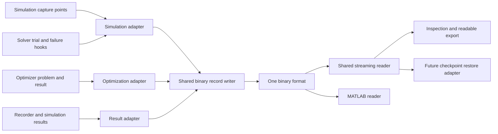

# Binary state, diagnostics, and optimization review

## Current status (2026-11-09)

State, diagnostic, recorder, sparse-matrix, and convergence captures use the
shared HDF5 implementation described in [binary-state-output.md](binary-state-output.md).
Periodic partitioned state capture now writes the differential and paired
algebraic blocks in one frame, including the initial accepted capture after
partitioned startup conditions. This document's original review was written on
2026-10-30; its design inventory and implementation sequence below are retained
as historical context, not as a current list of unimplemented work.

`ModelDescription` and `ModelFieldSnapshot` now provide per-object declarations
and snapshots for parameters, flags, retained local state, and solver-state
layout metadata. They do not yet capture a whole simulation. See
[Checkpointing and restore boundaries](checkpointing.md) for the current split
between HDF5 solver frames, object-field snapshots, the solution-only power-flow
JSON checkpoint, and the missing full dynamic restore coordinator.

Reviewed 2026-10-30 against the working tree based on `c6d24432`, including the
uncommitted binary-output changes. This is a source and architecture review;
the historical large-case benchmarks below were not rerun for this review.

## Historical conclusion and scope (2026-10-30)

Keep one binary storage format and one implementation of numeric storage,
reading, and buffering. Simulation snapshots, nonlinear-solver
diagnostics, optimization problems/results, Jacobian captures, recorder output
and simulation result tables should be
adapters over that implementation. A future checkpoint manifest should refer
to complete captured frames and model/parameter files rather than inventing
another numeric representation.

At the time of this review, the implementation shared numeric encoding between
simulation and diagnostic writers, but partitioned periodic output did not
capture the paired algebraic state. That gap has since been closed: the current
HDF5 adapter writes paired solver blocks in the same frame. HDF5 also provides
the neutral storage API; the remaining gap is whole-simulation capture and
restore, not selection of a numeric container. The solver-facing adapter still
uses `SolverMode` to select its blocks.

This review precedes the next implementation/refactoring step. It does not add
checkpoint restore, parameter restoration, optimizer serialization, or a new
wire-format revision. The follow-on
[HDF5 integration assessment](hdf5-integration-assessment.md) includes simulation
output as a required application, compilation probes and a preliminary Parquet
comparison.

## Historical standard-format assessment (2026-10-30)

This assessment recommended against extending `GDSTATE1` and selected HDF5 as
the sole numerical container. That recommendation is now implemented. The
current schema and APIs are documented in [binary-state-output.md](binary-state-output.md).
The original assessment was a design recommendation based on the requirements
and published capabilities. Production HDF5 integration now exists; no
comparative performance benchmark against the removed custom format is recorded
here. The earlier standalone compilation checks are in the
[integration assessment](hdf5-integration-assessment.md).

| Candidate      | Fit for GridDyn                                                                                                                                                                                                      | Main cost or limitation                                                                                                                                                                                                                          |
| -------------- | -------------------------------------------------------------------------------------------------------------------------------------------------------------------------------------------------------------------- | ------------------------------------------------------------------------------------------------------------------------------------------------------------------------------------------------------------------------------------------------ |
| **HDF5**       | Typed arrays, named groups and attributes, partial reads/writes, extendible datasets and optional lossless compression. A good match for state blocks, sparse-matrix arrays, optimization data and capture metadata. | Adds a compiled dependency and requires careful dataset/chunk design, resource handling and interruption policy. It supplies storage, not GridDyn capture semantics.                                                                             |
| **netCDF-4**   | Also supports groups, typed variables, compression and unlimited dimensions, using HDF5 storage.                                                                                                                     | Its dimension/variable model is useful for conventional scientific time series, but offers no clear simplification for the heterogeneous solver/optimizer captures here over HDF5 directly.                                                      |
| **NPY/NPZ**    | Simple typed-array interchange. NPY includes shape, dtype and byte order; NPZ packages multiple NPY arrays in ZIP.                                                                                                   | Frame identity, indexing, append organization, sparse structure and metadata associations would still require an application protocol. Better suited to exporting arrays than the common capture store.                                          |
| **SQLite**     | Already bundled by the top-level CMake build. Transactions and queries suit frame metadata and atomic multi-record commits.                                                                                          | Bulk arrays would normally be BLOBs, leaving GridDyn responsible for their numeric encoding, shape, chunking and analysis readers. Storing every scalar as a row is a poor starting design for these workloads.                                  |
| **ADIOS2 BP5** | Designed around scientific output steps, large arrays and scalable I/O; worth considering if distributed simulation output becomes the dominant requirement.                                                         | Adds a different library/tooling stack. Its documented BP5 representation is a directory containing metadata/data files; MATLAB interoperability would need separate evaluation. These costs are harder to justify for the current requirements. |

Primary references: [HDF5 datasets](https://support.hdfgroup.org/documentation/hdf5/latest/_h5_d__u_g.html),
[netCDF data model](https://docs.unidata.ucar.edu/netcdf-c/current/netcdf_data_model.html)
and [FAQ](https://docs.unidata.ucar.edu/netcdf-c/current/faq.html),
[NumPy formats](https://numpy.org/doc/stable/reference/generated/numpy.lib.format.html),
[SQLite atomic commits](https://www.sqlite.org/atomiccommit.html)
and [types](https://www.sqlite.org/datatype3.html), and
[ADIOS2 BP5](https://adios2.readthedocs.io/en/v2.12.0/engines/engines.html).

### Historical HDF5 schema proposal

The following organization was illustrative and was not adopted as schema
version 1. The implemented datasets and record fields are documented in
[binary-state-output.md](binary-state-output.md).

Store arrays as ordinary HDF5 datasets. HDF5 would own physical types,
byte-order conversion, dataset
dimensions, partial I/O and compression. GridDyn would own a small, versioned
schema for layouts, source/role, frame identity, exact time, evaluation stage,
solver context and required block membership. This schema must remain neutral
to `SolverMode` and `OptimizationMode`.

Illustrative organization, not a frozen schema:

```text
/                         attributes: format, schema_version, producer
/layouts/<id>/            names, roles, units and component identities
/frames/                  IDs, times, context and completed-frame index
/vectors/<series>/        layout_id, role, frame_ids, values
/matrices/<series>/       shape, index_base, frame_ids, offsets,
                          row_indices, column_indices, values
/optimization/<capture>/  bounds, types, objective data and result metadata
```

For a stable vector layout, append samples to a chunked two-dimensional dataset
rather than creating a group and many tiny datasets per callback. Changing
layouts start a new series. Sparse COUP arrays and per-sample offsets preserve
the current producers' entries without constructing dense matrices; explicitly
record shape, index width, structural zeros and layout associations. A future
CSR representation would be a documented schema choice measured against those
producers, not an assumption that HDF5 defines a universal sparse matrix type.

One C++ owner can wrap the HDF5 C API with RAII and contain library errors at
the existing capture boundary. The library supports CMake discovery; this would
be a new explicit dependency in this repository. MATLAB can inspect/read/write
datasets with `h5info`, `h5read` and `h5write`; Python can use `h5py`. Their
GridDyn helpers would assemble logical frames and sparse matrices instead of
decoding bytes. An arbitrary HDF5 file is not automatically a MATLAB MAT-file.
See [HDF5 CMake integration](https://github.com/HDFGroup/hdf5/blob/develop/docs/USING_HDF5_CMake.md),
[MATLAB HDF5 support](https://www.mathworks.com/help/matlab/hdf5-files.html)
and [h5py](https://docs.h5py.org/en/stable/quick.html).

### Performance, completeness and compatibility

Uncompressed binary64 values still occupy eight bytes each: ten million values
are 80 MB before metadata in either HDF5 or the current format. HDF5 adds
container overhead; compression may reduce size but is data dependent and
costs CPU. Use only lossless filters for restorable state. Chunk size, cache,
batch size and flush frequency need measurement for both large snapshots and
frequent diagnostic callbacks. Partial reads avoid loading the entire capture.
See [HDF5 chunking guidance](https://support.hdfgroup.org/documentation/hdf5-docs/advanced_topics/chunking_in_hdf5.html).

Write all required blocks before publishing a frame as complete. That marker
is a logical completeness protocol, not an atomic transaction across datasets
or a guarantee that an abruptly terminated ordinary HDF5 writer leaves a
readable file. For completed checkpoints, write to a temporary destination,
close successfully, then publish the artifact/manifest; define filesystem
durability separately. Diagnostic crash recovery needs an explicit experiment.
HDF5 SWMR supports concurrent readers, but requires newer file structures and
precreated objects, and restricts variable-length/string updates. It should not
be enabled by default merely to label output as streamed. See
[SWMR requirements](https://portal.hdfgroup.org/documentation/hdf5/latest/_s_w_m_r_t_n.html).

Select a file-format feature baseline and filters compatible with the analysis
tools actually supported. MATLAB's high-level `h5create` dates to R2011a, but
that alone does not establish compatibility of newer HDF5 features with the
installed R2013a. Check dimensions/order, integer types, names, empty arrays,
all-zero/rectangular matrices and optional compression in real cross-language
fixtures. See [MATLAB version history](https://www.mathworks.com/help/matlab/ref/h5create.html).

At the time of the review, the next decision was to follow a small HDF5
experiment: large vector and
sparse-array round trips, many small diagnostic frames, partial reads,
interrupted writes and append/reopen behavior. Compare with the current format
using equivalent capture/flush policies, while distinguishing format costs from
its present per-record reopen overhead. Measure file size, throughput, peak
extra memory and solver slowdown. If HDF5 meets the acceptance criteria, use
it for all consolidated numeric output and retire the custom format; do not
maintain two production writers. The readable checkpoint manifest can refer
to `state.h5` plus editable parameter/runtime files.

## Current producers, readers, and ownership

| Application                             | Existing mechanism                                                                                                                                                                            | Coverage and limitation                                                                                                                                                                     |
| --------------------------------------- | --------------------------------------------------------------------------------------------------------------------------------------------------------------------------------------------- | ------------------------------------------------------------------------------------------------------------------------------------------------------------------------------------------- |
| Solver snapshot                         | `saveStateBinary` / `readStateBinary` / `loadStateBinary` in [GridDynSimulationFileOps.cpp](../../src/griddyn/simulation/GridDynSimulationFileOps.cpp)                                        | One initialized solver block, plus its initialized paired block when present; differential blocks include derivatives. Load copies vectors into initialized solvers.                        |
| Periodic dynamic recording              | `dynInitialize` and the partitioned startup path schedule `saveStateBinary` in [gridDynDynamic.cpp](../../src/griddyn/simulation/gridDynDynamic.cpp)                                          | DAE records include state and derivatives. Partitioned frames include the differential block and its paired algebraic block; the initial partitioned frame follows startup-condition setup. |
| IDA trial diagnostics                   | `idaFunc` in [IdaInterface.cpp](../../src/griddyn/solvers/IdaInterface.cpp)                                                                                                                   | Callback state, supplied derivatives, and residual; trial time and evaluation index.                                                                                                        |
| CVODE / ARKODE trial diagnostics        | `cvodeFunc` / `arkodeFunc` in [CvodeInterface.cpp](../../src/griddyn/solvers/CvodeInterface.cpp) and [ArkodeInterface.cpp](../../src/griddyn/solvers/ArkodeInterface.cpp)                     | Differential trial state and computed RHS. Algebraic work happens through a paired solver and lacks a shared evaluation identity.                                                           |
| Nonlinear algebraic diagnostics         | `kinsolFunc` in [KinsolInterface.cpp](../../src/griddyn/solvers/KinsolInterface.cpp)                                                                                                          | Algebraic trial state and residual; its local evaluation counter does not identify the enclosing differential trial.                                                                        |
| Solver Jacobians                        | `sundialsJac` in [SundialsInterface.cpp](../../src/griddyn/solvers/SundialsInterface.cpp)                                                                                                     | Shared sparse-record writer stores matrix dimensions and actual `cj`; evaluation-stage and layout associations are not complete.                                                            |
| Explicit Jacobian captures              | `captureJacState` / `saveJacobian`                                                                                                                                                            | Shared vector, sparse, and names records. The recorded `cj` is the helper's fixed value of 10000, not the active solver's linearization context.                                            |
| Convergence exploration                 | `dynamicSolverConvergenceTest` in [Diagnostics.cpp](../../src/griddyn/simulation/Diagnostics.cpp)                                                                                             | Uses `Hdf5DataFile` and the shared diagnostic-vector adapter. Its trial and result codes are documented in [binary-state-output.md](binary-state-output.md).                                |
| IC, root, and performance investigation | IDA reports and `partitionedDiagnostic`                                                                                                                                                       | Useful bounded text and counters, but their context is not linked to binary captures. Text remains appropriate for summaries; numerical payloads should use the shared records.             |
| Optimization                            | [OptimizerInterface](../../src/optimization/optimizerInterface.h), [NativeQpProblem](../../src/optimization/nativeProblem.h), [NativeSolveResult](../../src/optimization/nativeDenseSolver.h) | Own canonical arrays, names, dimensions, and results. No shared binary-output adapter was found.                                                                                            |
| MATLAB / Octave                         | [readStateFile.m](../../matlab/readStateFile.m), Jacobian and CVODE helpers                                                                                                                   | Decode the common format with frame/source/key/code selection and bounded index/payload reads. Jacobian state, matrix, and names are selected together by frame and key.                    |
| Initial power-flow solution checkpoint  | `savePowerFlowCheckpoint` / `loadPowerFlowCheckpoint`                                                                                                                                         | A separate JSON solution-only API exists. It is not an iterated-run or dynamic checkpoint; it may later share lower-level capture primitives.                                               |
| Simulation recorder output              | `Recorder::saveFile` / `TimeSeriesMulti`                                                                                                                                                      | Shared HDF5 for `.h5`/`.hdf5`; text for `.csv`/`.txt`; existing binary otherwise. Autosave, append, reset and explicit buffer exports are preserved.                                        |
| Power-flow result output                | `savePowerFlow`, bus/link result exports                                                                                                                                                      | Several readable output paths; generic binary dispatch currently reaches the empty `savePowerFlowBinary` stub. HDF5 result tables require a real adapter.                                   |

Recorder/time-series and result tables are distinct data products. Recorder
HDF5 output uses the shared storage implementation while retaining its own
sampling and buffer contracts. Readable exports remain available alongside the
common numeric format. Power-flow result HDF5 tables and optimizer persistence
are separate adapters, not prerequisites for dynamic checkpoint restore.

## Current findings for complete checkpoint restore

### 1. Solver frames are synchronized; model/runtime capture is still separate

Periodic DAE captures store state and derivative vectors. Partitioned captures
store the differential block and its initialized algebraic partner in one HDF5
frame; the startup path records its initial frame after the partitioned startup
conditions. These solver frames still do not include component fields, the
simulation clock, event queue progress, or a restartable solver history. The
`loadStateBinary` API copies vectors into an initialized solver and is not the
restore coordinator for a dynamic simulation.

### 2. Metadata must identify what the arrays mean

The HDF5 schema now records complete-frame identity, solver keys, paired keys,
vector roles, explicit sparse-matrix dimensions, and the Jacobian `cj` when
available. Names are supported records, but ordinary solver snapshots do not
currently write a named state layout. `ModelDescription` can produce active
state names and locations; the checkpoint capture adapter should record those
names (or a stable layout descriptor) with each solver block so restore can
check more than vector size and mode bits. Trial diagnostics still need richer
cross-solver evaluation and accepted-step context for some workflows.

### 3. Shared storage exists; capture adapters remain domain-specific

`Hdf5DataFile` in `src/utilities` now owns the shared typed-vector, sparse-matrix,
name-record, streaming-read, and frame-publication implementation. Simulation,
solver diagnostics, recorder, and convergence code use adapters over that
store. The remaining checkpoint work is to define a domain-neutral logical
simulation snapshot and connect model fields and runtime records to it. An
optimization capture adapter is still future work and should use its canonical
problem structures rather than fabricate a `SolverMode`.

### 4. HDF5 buffering and diagnostic failure handling are implemented

The current implementation keeps solver diagnostic file sessions open, batches
related records, writes vectors contiguously, and emits sparse data in bounded
chunks. Optional callback capture catches I/O failures, logs a warning, and
disables capture without changing the numerical callback return value. Required
snapshot writes report errors. HDF5 frame publication is a logical completeness
marker, not a crash-durability guarantee; see the format documentation for that
boundary.

### 5. Remaining parallel paths and misleading interfaces need cleanup

- `dynamicSolverConvergenceTest` now writes through the common HDF5 diagnostic
  path; it no longer maintains a separate raw binary writer.
- `saveStateXML` and `loadStateXML` remain empty. `LOAD state`, `CHECKPOINT`, and
  `ROLLBACK` action execution also remain unimplemented; their parser entries
  do not imply working restore behavior.
- Ordinary HDF5 solver snapshots still omit state names. The
  [checkpointing guide](checkpointing.md) records this as a layout-validation
  gap for restore.
- The MATLAB Jacobian helpers now share frame/key selection through the common
  state reader.
- The power-flow JSON checkpoint remains a solution-only API. A future common
  capture layer can back both that readable view and dynamic restart without
  broadening the existing API's promise.

## What the solver investigations require from capture

The primary history is in [IDA initial-condition diagnostics](ida-initial-condition-diagnostics.md),
[partitioned solver performance](partitioned-solver-performance-benchmark.md),
and the later [ACTIVSg25k investigation](activsg25k-dynamic-investigation.md).
These are investigation logs containing superseded observations as well as
later fixes. Their timings and completion reports apply to their recorded
inputs/configurations; they are not new benchmark results from this review.

| Investigation step                        | Evidence and resolution recorded in the documents                                                                                                                                                                                | Capture requirement                                                                                                                                                                                          |
| ----------------------------------------- | -------------------------------------------------------------------------------------------------------------------------------------------------------------------------------------------------------------------------------- | ------------------------------------------------------------------------------------------------------------------------------------------------------------------------------------------------------------ |
| Reproduce the actual run                  | Wrong case paths, invalid parameter scope and startup-only exits produced misleading apparent passes. Validate the static operating point before attributing a failure to dynamics.                                              | Input/model references, configuration, build/backend identity, requested and reached times, final status.                                                                                                    |
| Distinguish IC attempts                   | A failed fixed/masked IDA attempt could recover through fixed-differential IC. A small DAE residual could coexist with a large physical derivative.                                                                              | Initializer output, each IC trial and result, `y`, `yp`, residual, variable types, mask, IC strategy and status.                                                                                             |
| Trace equations and limits                | Out-of-service reactive-power allocation, limiter Jacobian signs, inactive GGOV1 branches and zero-rate limit roots caused different failures.                                                                                   | Named layouts, bounds/effective limits, selected branch/mode, raw residual/RHS, root owner/direction, before/after event frames.                                                                             |
| Isolate sparse-solver faults              | KLU singular-factor handling, clearing sparse indices with `SUNMatZero`, and stale symbolic factorization were isolated separately from model equations.                                                                         | Matrix dimensions, exact stored pattern including structural zero slots, values, pattern revision, setup/factorization status and evaluation identity. A numeric matrix alone cannot explain symbolic reuse. |
| Compare accepted and trial values         | Corrected DAE IC had to be transferred into both partitioned vectors. ARKODE's accepted derivative had to be refreshed with `ARKodeGetDky`, matching CVODE's endpoint behavior.                                                  | Coupled blocks and derivative at the actual accepted endpoint; explicitly separate internal stage/RHS values.                                                                                                |
| Separate stiffness from nonlinear failure | The ARKODE equilibrium trace showed a step-dependent explicit stability boundary while algebraic solves remained successful; smaller steps preserved equilibrium. Later table/transient sweeps refined the usable configuration. | Backend/table, step and tolerance controls, accepted/rejected status, largest derivative/state changes and corresponding algebraic state. Do not classify every failure as an algebraic solve problem.       |
| Measure performance after correctness     | Residual/RHS/algebraic/Jacobian counters, pattern-union reuse and setup reuse exposed repeated algebraic work as a dominant partitioned cost. KINSOL's reported remainder includes factorization and other overhead.             | Timed phase/evaluation counters linked to frames; bounded opt-in payloads; direct measurements distinguished from inferred remainders.                                                                       |

The reusable workflow is: establish the static case, capture initialization and
IC attempts, inspect named residual/derivative and sparse structure, isolate
roots/model groups, verify small regressions, then compare no-disturbance and
disturbance runs while increasing duration. Binary artifacts should make that
workflow reproducible without introducing new model equations or perturbing
accepted simulation history.

## Recommended architecture

The storage portion of this proposal is now implemented by
`utilities::Hdf5DataFile`. The diagram and adapter layering remain useful for
future optimization capture and whole-simulation checkpoint/restore. Current
checkpoint limits are in [checkpointing.md](checkpointing.md).



1. **Neutral record layer.** `utilities::Hdf5DataFile` owns the common HDF5
   record schema, vector/name/sparse-matrix payloads, buffering, bounds checks,
   and logical frame publication. The storage API does not depend on
   `GridDynSimulation` or `SolverMode`; simulation adapters still use those
   types to select data to capture.
2. **Descriptors and frames.** Lightweight descriptors refer to source,
   layout, frame/evaluation, role and payload byte length. Descriptors carry
   richer metadata so it is not repeated beside every number. Frame completion
   identifies a complete multi-block capture. Unknown optional content can be
   ignored through container metadata; an unsupported required layout/version
   fails clearly.
3. **Simulation capture adapter.** Uses existing `SolverInterface` state and
   derivative accessors. The simulation driver owns synchronized accepted
   capture points and paired-block collection; backend hooks supply trial and
   failure views. Future solvers implement their normal solver-data interface
   and optional context hooks, not a new serializer.
4. **Optimization capture adapter.** Uses `OptimizerInterface` callback data,
   canonical `NativeQpProblem` and `NativeSolveResult`. It never rebuilds a
   second network formulation or fabricates `SolverMode` values.
5. **Readers and views.** One C++ record reader supports selection by domain,
   source, frame, role and layout, including metadata-only scans and bounded
   range reads. `readStateBinary` is a convenience adapter. MATLAB implements
   the same published schema and gains selectors for large files.

Keep a single canonical sparse payload initially, with explicit shape and index
width. Adapt `MatrixData` and `NativeSparseMatrix` by iteration/chunking rather
than constructing dense or duplicate matrices. Preserve the producer's stored
coordinates and structural zeros; merging entries or dropping zero slots is
not the serializer's decision. A compressed sparse payload is a later measured
optimization within the same record contract if coordinate output proves costly.

Small descriptor/status payloads can use the existing JSON library. Bulk state,
matrix and optimization arrays remain packed binary. The ordinary text logger
continues to present concise summaries and can include capture/frame IDs.

## Optimization mapping

The existing optimization contracts already provide most of the information:

| Existing owner                       | Proposed record roles                                                                                                                                                                                            |
| ------------------------------------ | ---------------------------------------------------------------------------------------------------------------------------------------------------------------------------------------------------------------- |
| `NativeQpProblem`                    | Initial primal values, variable and constraint bounds, variable types, tolerance hints, objective constant/linear/quadratic coefficients, affine constraint matrix/offsets, names and model revision.            |
| `OptimizerInterface`                 | Current primal, constraint function, objective gradient, multipliers when supplied, constraint Jacobian and objective/Lagrangian Hessian when available. Scratch buffers are not automatically persistent state. |
| `NativeSolveResult` / backend result | Candidate/accepted primal values, objective, status, iteration count and feasibility/stationarity/complementarity diagnostics. Record only dual/active-set data actually exposed by the backend.                 |

Use separate variable and constraint layouts, since their dimensions differ.
Current native constraint names are populated as `constraint[row]`; meaningful
model-row identities still need to be carried through the capture adapter.
Static optimization captures need no invented simulation time: frame and
iteration identity should work with an optional physical timestamp.
Declare units, bases, objective convention and scaling. The native objective
uses `sum(q[i] * x[i]^2)`, whereas the HiGHS adapter constructs the appropriate
half-quadratic convention. Canonical captures should use original GridDyn
coordinates; backend-scaled debug arrays must be labelled with their transforms.
Do not infer a Hessian or serialize a backend's private workspace as a portable
warm start. Optimal-result capture and physical-model write-back remain separate
operations.

## Future parameter and checkpoint wrapper

A readable manifest can link the shared binary frame to model, parameter,
runtime and asset files. HDF5 is the current numeric container, but this
illustrative manifest is not a current loader schema. `ModelFieldSnapshot`
provides the per-object field representation; whole-simulation enumeration,
identity, persistence, and restore coordination remain future work:

```json
{
  "format": "griddyn-checkpoint",
  "version": 1,
  "model": { "file": "model.json" },
  "parameters": { "file": "parameters.json" },
  "state": { "file": "state.h5", "frame_id": 42 },
  "runtime": { "file": "runtime.json" },
  "assets": []
}
```

Paths should resolve relative to the manifest. A complete checkpoint captures
the current parameters together with their associated state. Parameter files
need typed values, units/bases, model types, stable component identities and
connections; preserving only the original input files loses programmatic edits.
Runtime data will include clocks, event progress, discrete modes, limits and
component-specific history. Configured limits, temporary effective-limit
adjustments and active-limit state must remain distinguishable.

The record layer supplies complete frames and layouts; component adapters and
the future restore coordinator own reconstruction and solver reinitialization.
Do not automatically repair edited files, reconcile their physics, or veto user
parameter edits because the old state was produced with different values.
Parsing, supported-type, size and frame-completeness checks remain necessary
to load the requested values safely. Unsupported component persistence must
be reported explicitly rather than silently omitted.

## Historical implementation plan and verification (2026-10-30)

This sequence predates the HDF5 implementation and the `ModelFieldSnapshot`
work. It is preserved as the original plan; use the current status and remaining
restore scope in [checkpointing.md](checkpointing.md).

1. Evaluate HDF5 against the capture and interoperability requirements above
   before extending the custom format. Implement the neutral record layer and
   generic reader over the chosen single container. Exercise MATLAB against
   C++-generated fixtures. There is no requirement to retain historical readers.
2. Add explicit matrix shape/layout and evaluation context, complete-frame
   identity, and synchronized DAE/partitioned capture. Route the dormant raw
   convergence writer through this layer or remove it. Resolve the silent stubs.
3. Route IDA/CVODE/ARKODE/KINSOL capture through a common adapter with a contained
   I/O-error policy. Retain actual callback vectors and times. Add IC/root/linear
   setup metadata and link bounded text reports to captures.
4. Add recorder and simulation-result adapters to the same storage layer,
   preserving scheduling, autosave, append, reset and independent-export behavior.
5. Add optimization problem/result capture using its canonical contracts and
   rectangular matrix tests; maintain accepted-result write-back rules.
6. Measure encode/decode throughput, extra memory, file size and solver overhead
   at representative state/nnz counts before adding compression or alternate
   sparse storage. Then design the parameter/runtime manifest and restore layer.

The current HDF5 test coverage is summarized in
[binary-state-output.md](binary-state-output.md). In particular,
`Hdf5PartitionedStateRoundTrip` in [testpFlow.cpp](../../test/systemTests/testpFlow.cpp)
checks paired solver-block capture and vector loading. These tests do not
exercise whole-simulation field/event restore, optimizer persistence, or a
complete dynamic checkpoint cycle. The remaining checkpoint scope is listed in
[checkpointing.md](checkpointing.md).
