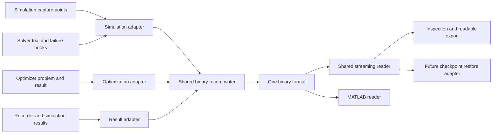

# Binary state, diagnostics, and optimization review

Implementation update: state and diagnostic output now use the HDF5 submodule
checkout supplied on `develop`. See [the current format and API](binary-state-output.md).
The design inventory and earlier build experiments below retain their historical
context; other application adapters are future work. LUT use is deferred until
last, if it is pursued at all.

Reviewed 2026-10-30 against the working tree based on `c6d24432`, including the
uncommitted binary-output changes. This is a source and architecture review;
the historical large-case benchmarks below were not rerun for this review.

## Conclusion and scope

Keep one binary storage format and one implementation of numeric storage,
reading, and buffering. Simulation snapshots, nonlinear-solver
diagnostics, optimization problems/results, Jacobian captures, recorder output
and simulation result tables should be
adapters over that implementation. A future checkpoint manifest should refer
to complete captured frames and model/parameter files rather than inventing
another numeric representation.

The current implementation has made a useful start: it shares little-endian
encoding, record headers/trailers, packed vectors, sparse coordinate entries,
and names between the simulation and SUNDIALS diagnostic writers. It is not
yet the reusable, complete capture layer described here. In particular,
partitioned periodic output does not capture the paired algebraic state, and
the record contract remains tied to `SolverMode`.

This review precedes the next implementation/refactoring step. It does not add
checkpoint restore, parameter restoration, optimizer serialization, or a new
wire-format revision. The follow-on
[HDF5 integration assessment](hdf5-integration-assessment.md) includes simulation
output as a required application, compilation probes and a preliminary Parquet
comparison.

## Standard-format assessment

The shared capture contract does not require a custom byte protocol. Before
extending `GDSTATE1`, evaluate HDF5 as the sole numerical container. This is a
design recommendation based on the requirements and published capabilities;
no production HDF5 integration or comparative performance benchmark has been
performed. Subsequent standalone compilation checks are recorded in the
[integration assessment](hdf5-integration-assessment.md).

| Candidate      | Fit for GridDyn                                                                                                                                                                                                      | Main cost or limitation                                                                                                                                                                                                                          |
| -------------- | -------------------------------------------------------------------------------------------------------------------------------------------------------------------------------------------------------------------- | ------------------------------------------------------------------------------------------------------------------------------------------------------------------------------------------------------------------------------------------------ |
| **HDF5**       | Typed arrays, named groups and attributes, partial reads/writes, extendible datasets and optional lossless compression. A good match for state blocks, sparse-matrix arrays, optimization data and capture metadata. | Adds a compiled dependency and requires careful dataset/chunk design, resource handling and interruption policy. It supplies storage, not GridDyn capture semantics.                                                                             |
| **netCDF-4**   | Also supports groups, typed variables, compression and unlimited dimensions, using HDF5 storage.                                                                                                                     | Its dimension/variable model is useful for conventional scientific time series, but offers no clear simplification for the heterogeneous solver/optimizer captures here over HDF5 directly.                                                      |
| **NPY/NPZ**    | Simple typed-array interchange. NPY includes shape, dtype and byte order; NPZ packages multiple NPY arrays in ZIP.                                                                                                   | Frame identity, indexing, append organization, sparse structure and metadata associations would still require an application protocol. Better suited to exporting arrays than the common capture store.                                          |
| **SQLite**     | Already bundled by the top-level CMake build. Transactions and queries suit frame metadata and atomic multi-record commits.                                                                                          | Bulk arrays would normally be BLOBs, leaving GridDyn responsible for their numeric encoding, shape, chunking and analysis readers. Storing every scalar as a row is a poor starting design for these workloads.                                  |
| **ADIOS2 BP5** | Designed around scientific output steps, large arrays and scalable I/O; worth considering if distributed simulation output becomes the dominant requirement.                                                         | Adds a different library/tooling stack. Its documented BP5 representation is a directory containing metadata/data files; MATLAB interoperability would need separate evaluation. These costs are harder to justify for the current requirements. |

Primary references: [HDF5 datasets](https://support.hdfgroup.org/documentation/hdf5/latest/_h5_d__u_g.html),
[netCDF data model](https://docs.unidata.ucar.edu/netcdf-c/current/netcdf_data_model.html)
and [FAQ](https://docs.unidata.ucar.edu/netcdf-c/current/faq.html),
[NumPy formats](https://numpy.org/doc/stable/reference/generated/numpy.lib.format.html),
[SQLite atomic commits](https://www.sqlite.org/atomiccommit.html)
and [types](https://www.sqlite.org/datatype3.html), and
[ADIOS2 BP5](https://adios2.readthedocs.io/en/v2.12.0/engines/engines.html).

### Proposed HDF5 use

Store arrays as ordinary HDF5 datasets. HDF5 would own physical types,
byte-order conversion, dataset
dimensions, partial I/O and compression. GridDyn would own a small, versioned
schema for layouts, source/role, frame identity, exact time, evaluation stage,
solver context and required block membership. This schema must remain neutral
to `SolverMode` and `OptimizationMode`.

Illustrative organization, not a frozen schema:

```text
/                         attributes: format, schema_version, producer
/layouts/<id>/            names, roles, units and component identities
/frames/                  IDs, times, context and completed-frame index
/vectors/<series>/        layout_id, role, frame_ids, values
/matrices/<series>/       shape, index_base, frame_ids, offsets,
                          row_indices, column_indices, values
/optimization/<capture>/  bounds, types, objective data and result metadata
```

For a stable vector layout, append samples to a chunked two-dimensional dataset
rather than creating a group and many tiny datasets per callback. Changing
layouts start a new series. Sparse COUP arrays and per-sample offsets preserve
the current producers' entries without constructing dense matrices; explicitly
record shape, index width, structural zeros and layout associations. A future
CSR representation would be a documented schema choice measured against those
producers, not an assumption that HDF5 defines a universal sparse matrix type.

One C++ owner can wrap the HDF5 C API with RAII and contain library errors at
the existing capture boundary. The library supports CMake discovery; this would
be a new explicit dependency in this repository. MATLAB can inspect/read/write
datasets with `h5info`, `h5read` and `h5write`; Python can use `h5py`. Their
GridDyn helpers would assemble logical frames and sparse matrices instead of
decoding bytes. An arbitrary HDF5 file is not automatically a MATLAB MAT-file.
See [HDF5 CMake integration](https://github.com/HDFGroup/hdf5/blob/develop/docs/USING_HDF5_CMake.md),
[MATLAB HDF5 support](https://www.mathworks.com/help/matlab/hdf5-files.html)
and [h5py](https://docs.h5py.org/en/stable/quick.html).

### Performance, completeness and compatibility

Uncompressed binary64 values still occupy eight bytes each: ten million values
are 80 MB before metadata in either HDF5 or the current format. HDF5 adds
container overhead; compression may reduce size but is data dependent and
costs CPU. Use only lossless filters for restorable state. Chunk size, cache,
batch size and flush frequency need measurement for both large snapshots and
frequent diagnostic callbacks. Partial reads avoid loading the entire capture.
See [HDF5 chunking guidance](https://support.hdfgroup.org/documentation/hdf5-docs/advanced_topics/chunking_in_hdf5.html).

Write all required blocks before publishing a frame as complete. That marker
is a logical completeness protocol, not an atomic transaction across datasets
or a guarantee that an abruptly terminated ordinary HDF5 writer leaves a
readable file. For completed checkpoints, write to a temporary destination,
close successfully, then publish the artifact/manifest; define filesystem
durability separately. Diagnostic crash recovery needs an explicit experiment.
HDF5 SWMR supports concurrent readers, but requires newer file structures and
precreated objects, and restricts variable-length/string updates. It should not
be enabled by default merely to label output as streamed. See
[SWMR requirements](https://portal.hdfgroup.org/documentation/hdf5/latest/_s_w_m_r_t_n.html).

Select a file-format feature baseline and filters compatible with the analysis
tools actually supported. MATLAB's high-level `h5create` dates to R2011a, but
that alone does not establish compatibility of newer HDF5 features with the
installed R2013a. Check dimensions/order, integer types, names, empty arrays,
all-zero/rectangular matrices and optional compression in real cross-language
fixtures. See [MATLAB version history](https://www.mathworks.com/help/matlab/ref/h5create.html).

The next decision should follow a small HDF5 experiment: large vector and
sparse-array round trips, many small diagnostic frames, partial reads,
interrupted writes and append/reopen behavior. Compare with the current format
using equivalent capture/flush policies, while distinguishing format costs from
its present per-record reopen overhead. Measure file size, throughput, peak
extra memory and solver slowdown. If HDF5 meets the acceptance criteria, use
it for all consolidated numeric output and retire the custom format; do not
maintain two production writers. The readable checkpoint manifest can refer
to `state.h5` plus editable parameter/runtime files.

## Current producers, readers, and ownership

| Application                             | Existing mechanism                                                                                                                                                                            | Coverage and limitation                                                                                                                                                                     |
| --------------------------------------- | --------------------------------------------------------------------------------------------------------------------------------------------------------------------------------------------- | ------------------------------------------------------------------------------------------------------------------------------------------------------------------------------------------- |
| Single-mode solver snapshot             | `saveStateBinary` / `readStateBinary` / `loadStateBinary` in [GridDynSimulationFileOps.cpp](../../src/griddyn/simulation/GridDynSimulationFileOps.cpp)                                        | One initialized solver's state, derivatives when differential, time, and mode. Load copies vectors; it does not reinitialize a solver or simulation.                                        |
| Periodic dynamic recording              | `dynInitialize` schedules `saveStateBinary` in [gridDynDynamic.cpp](../../src/griddyn/simulation/gridDynDynamic.cpp)                                                                          | DAE records include the combined state. Partitioned recording selects the differential mode and omits its algebraic partner.                                                                |
| IDA trial diagnostics                   | `idaFunc` in [IdaInterface.cpp](../../src/griddyn/solvers/IdaInterface.cpp)                                                                                                                   | Callback state, supplied derivatives, and residual; trial time and evaluation index.                                                                                                        |
| CVODE / ARKODE trial diagnostics        | `cvodeFunc` / `arkodeFunc` in [CvodeInterface.cpp](../../src/griddyn/solvers/CvodeInterface.cpp) and [ArkodeInterface.cpp](../../src/griddyn/solvers/ArkodeInterface.cpp)                     | Differential trial state and computed RHS. Algebraic work happens through a paired solver and lacks a shared evaluation identity.                                                           |
| Nonlinear algebraic diagnostics         | `kinsolFunc` in [KinsolInterface.cpp](../../src/griddyn/solvers/KinsolInterface.cpp)                                                                                                          | Algebraic trial state and residual; its local evaluation counter does not identify the enclosing differential trial.                                                                        |
| Solver Jacobians                        | `sundialsJac` in [SundialsInterface.cpp](../../src/griddyn/solvers/SundialsInterface.cpp)                                                                                                     | Shared sparse-record writer; the file lacks the actual `cj`, evaluation-stage context, explicit matrix shape, and layout associations.                                                      |
| Explicit Jacobian captures              | `captureJacState` / `saveJacobian`                                                                                                                                                            | Shared vector, sparse, and names records. Both evaluate using a hard-coded `cj = 10000`, rather than a recorded solver linearization context.                                               |
| Convergence exploration                 | `dynamicSolverConvergenceTest` in [Diagnostics.cpp](../../src/griddyn/simulation/Diagnostics.cpp)                                                                                             | Still writes a separate unversioned binary stream directly. Its only discovered call is commented out, but retaining the writer preserves a competing format.                               |
| IC, root, and performance investigation | IDA reports and `partitionedDiagnostic`                                                                                                                                                       | Useful bounded text and counters, but their context is not linked to binary captures. Text remains appropriate for summaries; numerical payloads should use the shared records.             |
| Optimization                            | [OptimizerInterface](../../src/optimization/optimizerInterface.h), [NativeQpProblem](../../src/optimization/nativeProblem.h), [NativeSolveResult](../../src/optimization/nativeDenseSolver.h) | Own canonical arrays, names, dimensions, and results. No shared binary-output adapter was found.                                                                                            |
| MATLAB / Octave                         | [readStateFile.m](../../matlab/readStateFile.m), Jacobian and CVODE helpers                                                                                                                   | Decode the common format. Helpers currently select first/last matching records without frame/layout correlation and load the complete file into memory.                                     |
| Initial power-flow solution checkpoint  | `savePowerFlowCheckpoint` / `loadPowerFlowCheckpoint`                                                                                                                                         | A separate JSON solution representation exists. It is not an iterated-run checkpoint and should eventually be a view/adapter over the same capture model.                                   |
| Simulation recorder output              | `Recorder::saveFile` / `TimeSeriesMulti`                                                                                                                                                      | Text for `.csv`/`.txt`, a separate time-series binary codec for every other extension. HDF5 needs explicit dispatch and a shared storage adapter preserving autosave/append/reset behavior. |
| Power-flow result output                | `savePowerFlow`, bus/link result exports                                                                                                                                                      | Several readable output paths; generic binary dispatch currently reaches the empty `savePowerFlowBinary` stub. HDF5 result tables require a real adapter.                                   |

Recorder/time-series and result tables are distinct data products, now explicitly
required to use the proposed common HDF5 storage implementation. They retain
their own sampling/table contracts rather than masquerading as solver snapshots.
Readable exports can continue alongside the single consolidated numeric format.

## Findings to address before building restore

### 1. Partitioned capture needs a complete, synchronized frame

`dynInitialize` chooses `defDynDiffMode` for partitioned execution and captures
that solver alone. `setupDynamicPartitioned` later initializes the paired
algebraic solver and can transfer corrected DAE initial conditions into both
vectors. The initial periodic record can therefore precede that final
partitioned setup. The snapshot encoding does not persist `pairedOffsetIndex`,
so the reconstructed `BinaryStateData` does not identify the missing algebraic block.

Recording two independent snapshots is insufficient: `readStateBinary` selects
the last snapshot, and `loadStateBinary` then compares it with the requested
mode. It cannot select a complete differential/algebraic pair from one frame.

Required direction:

- A capture frame contains all required blocks, their layout IDs, one exact
  time, stage, and a completion marker.
- DAE frames contain combined `y` and `yp`, with variable classification.
- Partitioned frames contain `x_d`, `dx_d/dt`, and `x_a` after the endpoint
  algebraic solve and cache updates. Include other solver-owned arrays only
  when their role is explicitly declared.
- Capture the initial accepted frame after the final selected initialization
  strategy has completed, and capture post-event frames after the full event
  correction. Trial and failure captures remain available with their own stage.
- Never run an extra algebraic solve just to serialize data. Capture policy
  chooses a synchronized point; serialization observes the supplied buffers.

### 2. Metadata must identify what the arrays mean

The current source values distinguish snapshots and diagnostics. They do not
identify the backend, the enclosing differential trial, IC attempt, root
transition, accepted step, model/layout revision, or matrix linearization.
Solver offsets and unrelated local counters cannot establish those links.

The format also has no matrix row/column dimensions. Inferring dimensions
from nonzero coordinates loses empty/trailing rows and columns and cannot
reliably represent a rectangular optimization constraint Jacobian. A DAE
Jacobian additionally needs its residual convention and actual `cj` to be
interpreted correctly. Explicit helper captures with `cj = 10000` must be
labelled as such or accept a caller-supplied evaluation context.

Use stable file-local producer, layout, frame, and evaluation IDs. Store names,
units/bases, mode descriptions, matrix shape and row/column layout references
in descriptors, usually once per layout revision. Record stage, return code,
`cj` where applicable, and parent evaluation at the capture point. A backend
name is metadata, not a separate binary format.

Use 64-bit frame/evaluation IDs and payload lengths/counts consistently. The
current diagnostic vector API narrows its count to `uint32_t`, and matrix
coordinates are restricted to 32 bits. Any retained compact index encoding
needs an explicit declared width and a checked adapter boundary.

### 3. The shared codec is still coupled to simulation policy

The byte helpers and record constants are private to the large simulation
file-operations implementation. Every public writer requires `SolverMode`.
The C++ reader parses general records internally but exposes only the last
simulation snapshot. Optimization would have to fabricate a simulation mode
or add another writer/reader, neither of which is appropriate.

Move the storage boundary into a neutral utility module, reusing the selected
container library rather than reimplementing its byte protocol. Expose typed record kinds,
headers/descriptors, a generic streaming reader and a writer. Keep the existing
simulation entry points as adapters. Add an optimization adapter using its
existing arrays and canonical problem representation. Preserve one authority
for each datum, as required by the [optimizer work plan](optimizer-work-plan.md).

The snapshot bundle and standalone vector records can remain convenience
operations over the same primitives; they should not have separate encoders
or independent definitions of state, derivative, and residual roles.

### 4. Buffering and diagnostic failure handling need a clear boundary

Each record currently reopens the file, reads the header and last marker for
append, writes a record, and closes it. IDA can do that three times per residual
evaluation. Sparse output invokes three stream writes per nonzero, in addition
to encoding each index and value. These are source-level costs; their runtime
impact has not been benchmarked in this review.

Use a session-scoped buffered writer, with header validation once per open,
contiguous vector writes and bounded chunks of sparse entries. Preserve
streaming and avoid a whole-case JSON DOM, dense matrix, or second full numeric
copy. Emit stable names and structure descriptions once when possible.

The optional diagnostic writers can currently throw from SUNDIALS callbacks,
which have no local I/O exception boundary. Define the policy in one capture
adapter: contain the error, retain an actionable message, and either disable
optional capture or return a deliberate solver callback failure according to
the selected policy. A required checkpoint write should fail explicitly.
Those policies should share the same encoding implementation.

The custom append check verifies header and final marker, not the complete
preceding record. If retained, a completed frame/footer should carry a length
or offset so checking an append boundary remains constant-time and stronger
than matching four trailing bytes. A standard container would instead own
physical structure checks; GridDyn must still establish frame completeness.
This is file-integrity handling, not model validation.

### 5. Remaining parallel paths and misleading interfaces need cleanup

- Migrate or remove `dynamicSolverConvergenceTest`'s raw binary writer. If
  retained, record its trial inputs, outputs, sweep coordinates, and status in
  the common format.
- `saveStateXML` and `loadStateXML` are empty, and the action handlers for
  loading state/checkpoint/rollback are stubs. They should report unsupported
  behavior until implemented, rather than imply successful state restoration.
- Ordinary snapshots omit names although named records exist. The format note
  must distinguish optional descriptors from the default capture content.
- Consolidate the duplicate `matlab` / `docgen/matlab` Jacobian helper logic.
  Select state, matrix, and names by compatible frame/layout instead of picking
  unrelated first or last records.
- The existing JSON power-flow checkpoint should not grow a second independent
  definition of numerical state. Retain readable export through the capture
  model and let a future manifest reference the binary payload.

## What the solver investigations require from capture

The primary history is in [IDA initial-condition diagnostics](ida-initial-condition-diagnostics.md),
[partitioned solver performance](partitioned-solver-performance-benchmark.md),
and the later [ACTIVSg25k investigation](activsg25k-dynamic-investigation.md).
These are investigation logs containing superseded observations as well as
later fixes. Their timings and completion reports apply to their recorded
inputs/configurations; they are not new benchmark results from this review.

| Investigation step                        | Evidence and resolution recorded in the documents                                                                                                                                                                                | Capture requirement                                                                                                                                                                                          |
| ----------------------------------------- | -------------------------------------------------------------------------------------------------------------------------------------------------------------------------------------------------------------------------------- | ------------------------------------------------------------------------------------------------------------------------------------------------------------------------------------------------------------ |
| Reproduce the actual run                  | Wrong case paths, invalid parameter scope and startup-only exits produced misleading apparent passes. Validate the static operating point before attributing a failure to dynamics.                                              | Input/model references, configuration, build/backend identity, requested and reached times, final status.                                                                                                    |
| Distinguish IC attempts                   | A failed fixed/masked IDA attempt could recover through fixed-differential IC. A small DAE residual could coexist with a large physical derivative.                                                                              | Initializer output, each IC trial and result, `y`, `yp`, residual, variable types, mask, IC strategy and status.                                                                                             |
| Trace equations and limits                | Out-of-service reactive-power allocation, limiter Jacobian signs, inactive GGOV1 branches and zero-rate limit roots caused different failures.                                                                                   | Named layouts, bounds/effective limits, selected branch/mode, raw residual/RHS, root owner/direction, before/after event frames.                                                                             |
| Isolate sparse-solver faults              | KLU singular-factor handling, clearing sparse indices with `SUNMatZero`, and stale symbolic factorization were isolated separately from model equations.                                                                         | Matrix dimensions, exact stored pattern including structural zero slots, values, pattern revision, setup/factorization status and evaluation identity. A numeric matrix alone cannot explain symbolic reuse. |
| Compare accepted and trial values         | Corrected DAE IC had to be transferred into both partitioned vectors. ARKODE's accepted derivative had to be refreshed with `ARKodeGetDky`, matching CVODE's endpoint behavior.                                                  | Coupled blocks and derivative at the actual accepted endpoint; explicitly separate internal stage/RHS values.                                                                                                |
| Separate stiffness from nonlinear failure | The ARKODE equilibrium trace showed a step-dependent explicit stability boundary while algebraic solves remained successful; smaller steps preserved equilibrium. Later table/transient sweeps refined the usable configuration. | Backend/table, step and tolerance controls, accepted/rejected status, largest derivative/state changes and corresponding algebraic state. Do not classify every failure as an algebraic solve problem.       |
| Measure performance after correctness     | Residual/RHS/algebraic/Jacobian counters, pattern-union reuse and setup reuse exposed repeated algebraic work as a dominant partitioned cost. KINSOL's reported remainder includes factorization and other overhead.             | Timed phase/evaluation counters linked to frames; bounded opt-in payloads; direct measurements distinguished from inferred remainders.                                                                       |

The reusable workflow is: establish the static case, capture initialization and
IC attempts, inspect named residual/derivative and sparse structure, isolate
roots/model groups, verify small regressions, then compare no-disturbance and
disturbance runs while increasing duration. Binary artifacts should make that
workflow reproducible without introducing new model equations or perturbing
accepted simulation history.

## Recommended architecture



1. **Neutral record layer**, for example `utilities/BinaryDataFile`. Owns
   the logical schema, typed vectors, sparse matrices, descriptors, buffering,
   bounds checks and storage errors. Delegate physical encoding and container
   structure to HDF5 if selected; maintain explicit logical frame completion. It
   has no dependency on `GridDynSimulation`, `SolverMode`, `OptimizationMode`,
   SUNDIALS, or a backend-specific result object.
2. **Descriptors and frames.** Lightweight descriptors refer to source,
   layout, frame/evaluation, role and payload byte length. Descriptors carry
   richer metadata so it is not repeated beside every number. Frame completion
   identifies a complete multi-block capture. Unknown optional content can be
   ignored through container metadata; an unsupported required layout/version
   fails clearly.
3. **Simulation capture adapter.** Uses existing `SolverInterface` state and
   derivative accessors. The simulation driver owns synchronized accepted
   capture points and paired-block collection; backend hooks supply trial and
   failure views. Future solvers implement their normal solver-data interface
   and optional context hooks, not a new serializer.
4. **Optimization capture adapter.** Uses `OptimizerInterface` callback data,
   canonical `NativeQpProblem` and `NativeSolveResult`. It never rebuilds a
   second network formulation or fabricates `SolverMode` values.
5. **Readers and views.** One C++ record reader supports selection by domain,
   source, frame, role and layout, including metadata-only scans and bounded
   range reads. `readStateBinary` is a convenience adapter. MATLAB implements
   the same published schema and gains selectors for large files.

Keep a single canonical sparse payload initially, with explicit shape and index
width. Adapt `MatrixData` and `NativeSparseMatrix` by iteration/chunking rather
than constructing dense or duplicate matrices. Preserve the producer's stored
coordinates and structural zeros; merging entries or dropping zero slots is
not the serializer's decision. A compressed sparse payload is a later measured
optimization within the same record contract if coordinate output proves costly.

Small descriptor/status payloads can use the existing JSON library. Bulk state,
matrix and optimization arrays remain packed binary. The ordinary text logger
continues to present concise summaries and can include capture/frame IDs.

## Optimization mapping

The existing optimization contracts already provide most of the information:

| Existing owner                       | Proposed record roles                                                                                                                                                                                            |
| ------------------------------------ | ---------------------------------------------------------------------------------------------------------------------------------------------------------------------------------------------------------------- |
| `NativeQpProblem`                    | Initial primal values, variable and constraint bounds, variable types, tolerance hints, objective constant/linear/quadratic coefficients, affine constraint matrix/offsets, names and model revision.            |
| `OptimizerInterface`                 | Current primal, constraint function, objective gradient, multipliers when supplied, constraint Jacobian and objective/Lagrangian Hessian when available. Scratch buffers are not automatically persistent state. |
| `NativeSolveResult` / backend result | Candidate/accepted primal values, objective, status, iteration count and feasibility/stationarity/complementarity diagnostics. Record only dual/active-set data actually exposed by the backend.                 |

Use separate variable and constraint layouts, since their dimensions differ.
Current native constraint names are populated as `constraint[row]`; meaningful
model-row identities still need to be carried through the capture adapter.
Static optimization captures need no invented simulation time: frame and
iteration identity should work with an optional physical timestamp.
Declare units, bases, objective convention and scaling. The native objective
uses `sum(q[i] * x[i]^2)`, whereas the HiGHS adapter constructs the appropriate
half-quadratic convention. Canonical captures should use original GridDyn
coordinates; backend-scaled debug arrays must be labelled with their transforms.
Do not infer a Hessian or serialize a backend's private workspace as a portable
warm start. Optimal-result capture and physical-model write-back remain separate
operations.

## Future parameter and checkpoint wrapper

A readable manifest can link the shared binary frame to model, parameter,
runtime and asset files. This illustrative future contract assumes HDF5 is
selected; it is not a current loader schema:

```json
{
  "format": "griddyn-checkpoint",
  "version": 1,
  "model": { "file": "model.json" },
  "parameters": { "file": "parameters.json" },
  "state": { "file": "state.h5", "frame_id": 42 },
  "runtime": { "file": "runtime.json" },
  "assets": []
}
```

Paths should resolve relative to the manifest. A complete checkpoint captures
the current parameters together with their associated state. Parameter files
need typed values, units/bases, model types, stable component identities and
connections; preserving only the original input files loses programmatic edits.
Runtime data will include clocks, event progress, discrete modes, limits and
component-specific history. Configured limits, temporary effective-limit
adjustments and active-limit state must remain distinguishable.

The record layer supplies complete frames and layouts; component adapters and
the future restore coordinator own reconstruction and solver reinitialization.
Do not automatically repair edited files, reconcile their physics, or veto user
parameter edits because the old state was produced with different values.
Parsing, supported-type, size and frame-completeness checks remain necessary
to load the requested values safely. Unsupported component persistence must
be reported explicitly rather than silently omitted.

## Ordered implementation and verification

1. Evaluate HDF5 against the capture and interoperability requirements above
   before extending the custom format. Implement the neutral record layer and
   generic reader over the chosen single container. Exercise MATLAB against
   C++-generated fixtures. There is no requirement to retain historical readers.
2. Add explicit matrix shape/layout and evaluation context, complete-frame
   identity, and synchronized DAE/partitioned capture. Route the dormant raw
   convergence writer through this layer or remove it. Resolve the silent stubs.
3. Route IDA/CVODE/ARKODE/KINSOL capture through a common adapter with a contained
   I/O-error policy. Retain actual callback vectors and times. Add IC/root/linear
   setup metadata and link bounded text reports to captures.
4. Add recorder and simulation-result adapters to the same storage layer,
   preserving scheduling, autosave, append, reset and independent-export behavior.
5. Add optimization problem/result capture using its canonical contracts and
   rectangular matrix tests; maintain accepted-result write-back rules.
6. Measure encode/decode throughput, extra memory, file size and solver overhead
   at representative state/nnz counts before adding compression or alternate
   sparse storage. Then design the parameter/runtime manifest and restore layer.

Existing tests in [testpFlow.cpp](../../test/systemTests/testpFlow.cpp) cover
single-mode round trips, appended snapshots, periodic DAE output, live solver
diagnostic callbacks, mixed numerical records and malformed files. The
[MATLAB tests](../../matlab/tests/testReadStateFile.m) consume C++-generated
fixtures. These do not prove a complete accepted partitioned snapshot, optimizer
persistence, or a complete checkpoint/restore cycle.

Add tests for synchronized differential/algebraic frames; selection among
multiple modes and layouts; IC/root/accepted-stage association; actual `cj` and
rectangular/all-zero matrices; optimizer bounds/types/units/scaling and result
status; structural-zero patterns; optional/required extension records; partial
frames and failed I/O; future solver adapters; and large streaming reads/writes.
Check capture enabled/disabled trajectories to ensure that observation does not
change numerical behavior. Keep historical large-case timings distinct from
fresh acceptance evidence.
