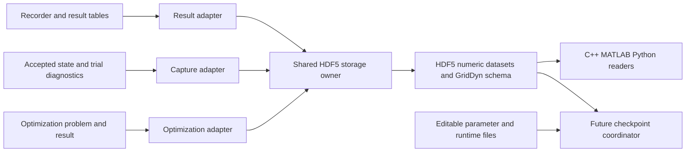

# HDF5 integration and preliminary Parquet comparison

Reviewed 2026-10-30 against the current working tree. This extends the
[binary-state architecture review](binary-state-architecture-review.md):
**simulation output data is a required application of the proposed common
storage layer**, alongside state, diagnostics, matrices and optimization.

## Recommendation and evidence boundary

HDF5 remains the strongest candidate for one common numerical container.
Use a small GridDyn C++ interface over the HDF5 **C API**, with resource ownership
and errors contained inside that implementation. The official C++ library is
usable for serial operation, but has important configuration restrictions.
Do not establish several production binary writers while evaluating alternatives.

The current upstream download page identifies HDF5 **2.2.0** as the newest
release; 1.14.6 is the final 1.14 release. The 2.2.0 archive was downloaded into
the ignored `build/hdf5-evaluation` directory and verified against its published
SHA256. This assessment includes actual Windows compilation and small data
round trips. It does not establish full application integration, performance,
crash recovery or a completed cross-platform acceptance matrix.
Sources: [downloads](https://support.hdfgroup.org/downloads/),
[2.2.0 release and checksums](https://support.hdfgroup.org/releases/hdf5/2.2.0/downloads/).

## License, compiler and platform compatibility

GridDyn's [LICENSE](../../LICENSE) is BSD-3-Clause. HDF5 2.2.0 describes its
library and utilities as covered by the three-clause BSD license, permitting
commercial use and redistribution. Linking it does not require relicensing
GridDyn. Distributions must retain the copyright, terms and disclaimer, with
the required notices accompanying binaries. Preserve the complete upstream
license, including its funding/portion notices, rather than substituting a
generic BSD template. Its additional text also addresses voluntarily supplied
enhancements; it does not require contributing GridDyn changes upstream.
See the [pinned HDF5 license](https://raw.githubusercontent.com/HDFGroup/hdf5/2.2.0/LICENSE).

Compression and other optional libraries have their own notices. An initial
uncompressed/deflate configuration can use the zlib family already present in
GridDyn, subject to verifying target reuse and packaging. SZIP, third-party
filter plugins, cloud connectors and their dependency sets are unnecessary
for the initial integration. Do not equate the HDF5 library license with the
licenses of every optional tool or plugin.

| Area | Evidence and implication |
| --- | --- |
| CMake | GridDyn requires 3.28 or newer; HDF5 2.2.0 requires 3.26. The version requirements overlap. Both support CMake builds. |
| Language standards | GridDyn requires C++23, GCC 14+ or Clang 18+. HDF5's implementation uses C11, and its native C++ build sets its own C++11 standard. A separately built dependency can use that standard while GridDyn remains C++23/26. Do not let dependency settings lower GridDyn's standard. |
| Local Windows compilation | HDF5 C and C++ static/shared Release libraries built with VS 2022 MSVC 19.44.35229, x64. The upstream sources emitted warnings; this is not a warning-free build claim. |
| C++23 consumers | Standalone programs including actual GridDyn headers compiled, linked and passed with MSVC 19.44 and clang-cl 19.1.5, for static and shared HDF5. clang-cl consumed the MSVC-built libraries; the whole dependency was not rebuilt with clang-cl. |
| C++26 consumer | The same static/shared probes passed with clang-cl 19.1.5 requesting CMake's C++26 mode (which emitted `-std:c++latest`). This is a header/ABI check, not proof of full C++26 language support or a GridDyn Clang 22 run. |
| Linux/macOS | Upstream supplies Linux GCC and macOS Clang artifacts and publishes test-platform information. Actual GridDyn integration must run on its Linux compiler matrix, macOS and ARM64; none of those executions occurred in this Windows assessment. |
| Windows ARM64/MinGW/other toolchains | Treat as separate target configurations if GridDyn supports them. Do not infer ABI compatibility from successful x64 MSVC builds or reuse MSVC C++ binaries with MinGW. |
| Native C++ plus thread safety | Upstream rejects `HDF5_BUILD_CPP_LIB=ON` with `HDF5_ENABLE_THREADSAFE=ON` unless `HDF5_ALLOW_UNSUPPORTED=ON`. Windows thread-safe builds also reject static libraries. These are real build constraints. |
| Native C++ plus MPI | Upstream similarly rejects the native C++ wrapper with `HDF5_ENABLE_PARALLEL=ON` unless unsupported combinations are allowed. A C API boundary leaves a supported path to MPI-enabled HDF5 later. |
| ABI/configuration | Match architecture, compiler ABI, standard library, Debug/Release and Windows runtime settings. Install and test the required DLLs or static dependencies. File portability does not imply library ABI interchangeability. |
| Build paths | The release lists CMake paths containing spaces as a known problem. The tested source/build/install paths contain no spaces; compiler paths containing spaces worked. Other path cases need an explicit test or documented constraint. |

Sources: [GridDyn CMake](../../CMakeLists.txt),
[compiler matrix](../../.github/workflows/compiler-tests.yml),
[CI matrix](../../.github/workflows/ci-tests.yml),
[wheel platforms](../../.github/workflows/wheels.yml),
[HDF5 build/configuration](https://raw.githubusercontent.com/HDFGroup/hdf5/2.2.0/CMakeLists.txt),
[C++ flags](https://raw.githubusercontent.com/HDFGroup/hdf5/2.2.0/config/flags/HDFCompilerCXXFlags.cmake),
[release notes](https://github.com/HDFGroup/hdf5/blob/2.2.0/release_docs/CHANGELOG.md)
and [upstream test platforms](https://github.com/HDFGroup/hdf5/wiki/Platforms-Tested).
The verified release archive is the source of the local build observations.

### Dependency and packaging approach

For reproducible development and CI, prefer a pinned submodule from the official
HDFGroup/hdf5 repository, following the SUNDIALS/HiGHS convention in GridDyn's
[submodule configuration](../../.gitmodules). Offer an explicit system-package
option for packagers and existing installations. Keep HDF5 headers out of public
GridDyn headers, normalize package target names in one CMake helper, and use
imported targets rather than hard-coded library filenames or directories.
The tested 2.2.0 config package exports `hdf5-static`, `hdf5-shared`,
`hdf5_cpp-static` and `hdf5_cpp-shared`; other distributions can expose different
aliases. Validate the requested components and enabled filters explicitly.

Keep build options scoped. HDF5 has generic `BUILD_STATIC_LIBS`,
`BUILD_SHARED_LIBS` and `BUILD_TESTING` options in addition to its own options;
embedding it must not change unrelated GridDyn dependencies. Source builds
should disable unneeded bindings, examples, tools, plugins and connectors.
Reuse the existing zlib through a verified target/package configuration rather
than letting HDF5 fetch a second copy implicitly. The local probe intentionally
disabled compression and did not yet test that reuse.

For static HDF5 inside GridDyn shared libraries/wheels, check position-independent
code, transitive dependencies, runtime selection and exported CMake packages.
For shared HDF5, test DLL/rpath discovery and wheel dependency repair on each OS.
FMI exports need an explicit packaging test. A `PRIVATE` CMake link does not
remove the need to deploy a dynamically linked library or its notices.

Python/MATLAB extensions can coexist with other clients using HDF5. Test actual
embedding scenarios for library-version/symbol collisions, error-handler changes,
file ownership and thread access. Do not replace another client's HDF5 DLL or
globally disable its version checks. Avoid process-global library shutdown while
other clients still own HDF5 objects.

## Storage ownership and common interface



A neutral utility, for example `Hdf5DataFile`, should own create/open/close,
typed dataset I/O, extend/append, selections, metadata, buffering and errors.
Expose array views, dimensions and lightweight descriptors, without requiring
`SolverMode`, `OptimizationMode` or HDF5 handles in its public interface. Domain
adapters supply meanings and synchronization. One physical implementation serves
all of them; result tables need not masquerade as solver-state frames.

One file session owns writing. Several recorders can write separate groups in
one run file through that owner, without each recorder truncating/reopening it.
Separate result/diagnostic/checkpoint files remain possible with the same schema
and implementation; sharing a format does not require putting every artifact
in one indefinitely growing file.

For a serial, non-thread-safe HDF5 build, serialize all HDF5 calls across the
process, including destruction, not just calls to one file. A GridDyn lock alone
cannot protect an external client using the same library instance. A thread-safe
C-library configuration is an alternative, subject to the platform/linkage
restrictions above. Thread safety, concurrent execution, MPI and SWMR are four
different capabilities; selecting one does not supply the others.

Asynchronous output requires owned data until the write completes. Solver
callback arrays cannot be queued as borrowed pointers while the solver mutates
them. Start with bounded synchronous/batched capture; measure before adding an
I/O worker and extra copies. Never allow storage exceptions to escape a solver's
C callback. Preserve the required-write versus optional-diagnostic error policies.

## Applying it to each data product

| Product | Required logical data and integration |
| --- | --- |
| Power-flow state / iterated studies | Solver vectors, layout, exact time where relevant, study/run/iteration identity and complete-frame marker. Checkpoint coordination also restores associated controls/parameters/runtime state; HDF5 alone does not supply rollback. |
| DAE and partitioned dynamics | State and derivative blocks, plus synchronized differential/algebraic partners for partitioned execution. Capture actual accepted vectors or actual trial callback views and label the stage. No extra solve/evaluation to produce a capture. |
| Solver diagnostics | Actual residual/RHS, evaluation/parent IDs, backend/mode, IC/root/status context and actual Jacobian `cj`. Keep accepted, trial and failed iterates distinguishable; bounded text summaries can refer to capture IDs. |
| Sparse Jacobians / Hessians | Explicit rectangular shape, index base/width, row/column layout, structure revision and numeric entries. COO fits the current diagnostic producer; CSR fits the native optimizer. They can share typed-array storage without forcing a dense matrix or changing stored zeros/duplicates. |
| Optimization | Canonical primal/constraint layouts, bounds/types, objective convention, matrix coefficients, units/scaling and candidate/accepted result status. Use existing canonical contracts; do not serialize backend workspaces as portable warm starts. |
| Simulation recorder output | Exact sample time, selected values, signal IDs/labels/units, sampling configuration and session/layout identity. Preserve existing grabber expression evaluation, scheduling, transformations, autosave and buffer ownership. |
| Power-flow and other result tables | Bus/link/generator IDs, named columns, units/bases and study metadata. Store typed columns or documented matrices with descriptors through the same storage layer. |

An illustrative file organization is:

```text
/                               format/schema/producer attributes
/runs/<run>/layouts/             state, signal, variable and constraint layouts
/runs/<run>/captures/            frame/context index and vector/matrix series
/runs/<run>/results/recorders/<id>/<session>/
    time_ns                     signed int64, appendable [sample]
    sample_id                   uint64 sequence (when required)
    values                      binary64 [sample, signal], tiled/chunked
    signals/                    labels, identities, units and expressions
/runs/<run>/results/powerflow/   typed bus/link/generator result columns
/runs/<run>/optimization/        canonical problem and result arrays
```

This is a design sketch, not a frozen loader schema. Store fixed-width physical
types explicitly: binary64 values, signed int64 nanoseconds, declared integer
indices. Simulation time is elapsed time, not a Unix datetime. Time can repeat
at events or restart after a reset; sample/frame/session identity must disambiguate
it. Do not depend on double precision to preserve every nanosecond integer.

Stable layouts permit sample batches in extendible datasets. Choose chunk tiles
for both sample-block writes and selected-signal/time-window reads. Separate
sampling grids use separate recorder groups; do not create a huge rectangular
table of unrelated rates filled with artificial missing values. Preserve null
and nonfinite value conventions explicitly. Large names/descriptors belong in
datasets rather than repeatedly copied per-sample metadata.

### Existing recorder and result contracts that must survive

[Recorder::saveFile](../../src/griddyn/measurement/Recorder.cpp) currently sends
`.csv`/`.txt` to text and **every other extension**, including `.h5`, to
`TimeSeriesMulti::writeBinaryFile`. HDF5 adoption therefore needs explicit format
dispatch; naming a current output `.h5` does not make it HDF5. The existing
[recorder contract](../recorders-and-grabbers.md) requires:

- First configured write replaces the file/session, subsequent writes append
  only unsaved samples; repeated empty flushes do no work.
- Successful autosave releases buffered samples; failed saves retain samples
  for retry. Storage must not advance the committed-row count prematurely.
- Independent snapshot exports do not move the configured sink's append position;
  aliases of that sink retain its identity.
- Signal/target/layout changes require reset. A new HDF5 session must respect
  that boundary and cannot quietly append rows under old signal descriptors.
- Recorder reset, sampling origins and finalization remain recorder policies.

Current append can construct a temporary `pending` time series. An HDF5 adapter
should consume the unsaved range or bounded tiles directly from the existing
column storage, avoiding another whole-buffer copy or full transpose. Column-wise
memory is compatible with dataset selections even when the logical file shape
is `[sample, signal]`. Multiple recorder schedules still use the existing collector.

[savePowerFlow](../../src/griddyn/simulation/GridDynSimulationFileOps.cpp) routes
unrecognized extensions to `savePowerFlowBinary`, currently an empty function.
Provide a real HDF5 result adapter with explicit dispatch and round-trip tests;
do not route `.h5` through that silent stub. Keep readable CSV exports. At binary
format adoption, make the mapping of older generic extensions explicit and
retire competing internal numeric encoders rather than retaining them indefinitely.

## Versioning, completion and recoverability

Keep the GridDyn schema version separate from the HDF5 library/API version and
the file-feature ceiling. Record producer information for diagnosis without
requiring readers to use that exact producer/library build. Use ordinary numeric
datasets, groups and descriptors that analysis tools can inspect directly.

The probe successfully used `H5Pset_libver_bounds(EARLIEST, V18)` with HDF5 2.2.0.
This demonstrates a feature ceiling, not actual MATLAB R2013a compatibility.
SWMR requires a newer feature baseline; the project must choose its required
reader versions and live-read behavior explicitly. Keep dimensions/order,
UTF-8 names/paths, integer types, empty arrays and supported filters in the
cross-language fixture suite. Generic HDF5 is not automatically a MAT-file.
See [format bounds](https://support.hdfgroup.org/documentation/hdf5/latest/group___f_a_p_l.html),
[MATLAB HDF5](https://www.mathworks.com/help/matlab/hdf5-files.html)
and [h5py](https://docs.h5py.org/en/stable/quick.html).

Use only lossless compression for restorable arrays. Begin with uncompressed and
optionally shuffle plus deflate, using readers' available filters. Check special
values and signed zero; do not use scale-offset quantization or assume every
third-party compression filter is installed. Benchmark chunk sizes and cache
budgets: compressed reads operate on chunks, and tiny writes can repeatedly
update the same chunk. Include memory and solver overhead in the measurements.
See [chunking](https://support.hdfgroup.org/documentation/hdf5-docs/advanced_topics/chunking_in_hdf5.html).

A complete frame/committed-row marker is an application protocol. Publish it
after its data and descriptors; readers ignore unfinished logical captures.
HDF5 flush is not a transaction spanning datasets or files, and it does not by
itself promise survival of every power failure. A required checkpoint can be
written/closed under a temporary name, with the manifest published last, retaining
the previous completed checkpoint until publication succeeds.

For ongoing diagnostics, ordinary HDF5 interrupted before close can need recovery.
SWMR improves file consistency but restricts creation of new objects and updates
of variable-length/string data. A live SWMR design can use precreated numeric
index/offset/byte-pool datasets or rotate completed segments when layouts change;
it cannot simply create a group per callback. Test the actual filesystem and
Windows/Linux/macOS drivers; upstream requires appropriate write semantics.
File locks are not a multi-writer coordination system. See
[SWMR](https://support.hdfgroup.org/documentation/hdf5/latest/_s_w_m_r_t_n.html)
and [locking](https://support.hdfgroup.org/documentation/hdf5/latest/_file_lock.html).

A future readable JSON manifest can reference a run/frame in `state.h5`, along
with editable parameter/runtime/model files. Parameter capture includes its
associated full state. Loading remains structural parsing and reconstruction;
it must not attempt to repair user-edited parameters or veto their physical
consistency, as established in the checkpoint requirements.

## Preliminary comparison with Parquet

Parquet is a strong candidate for simulation **result tables**, especially
analysis across many runs. It stores column chunks within row groups, supports
column selection and has an extensive tabular-analysis ecosystem. HDF5 can also
read selected columns through selections; performance depends on its chunk layout.
This is a workload comparison, not a claim that either format always wins.

| Requirement | HDF5 | Parquet |
| --- | --- | --- |
| Dense vectors / multidimensional blocks | Direct typed datasets and selections. | Represent with columns or nested lists, with shape/layout conventions supplied by GridDyn. |
| Sparse matrices and heterogeneous captures | Natural groups of arrays plus descriptors in one container. | Possible as COO tables/nested structures and related tables, but requires more application organization for shapes/layouts and associations. |
| Time-series tables | Good with deliberate signal/time tiling or column datasets. | A natural fit for columns, batched row groups and selecting signals. |
| Many-run analytics | Tools can scan arrays, but study indexing/query conventions are GridDyn's responsibility. | Strong fit for partitioned result datasets, column projection and predicate/statistics-driven scans. |
| Append while writer is open | Extend existing chunked datasets and explicitly publish completed ranges. | Write additional batches/row groups while the writer is open; this is supported and does not require buffering the full run. |
| Resume a closed artifact / edit a block | Reopen and extend/update datasets. | Not a general mutable-array container. A robust recorder design would usually publish additional completed part files; byte-appending to a finalized file is not sufficient because its footer indexes the contents. |
| Abrupt termination / live readers | Requires explicit completion/flush policy; SWMR or completed segments for stronger behavior. | Normal readers depend on the finalized footer. Completed part files bound exposure to the active part, but need a dataset/publication convention. |
| Parameter/state/result organization | Can share one hierarchical artifact and common storage utility. | Can represent all the data, but a collection of associated tables/files is less direct for the complete checkpoint/capture requirement. |
| C++ integration | C library plus a small GridDyn C++ owner; native wrapper optional. | Apache Arrow supplies the maintained Parquet C++ implementation; its selected components/dependencies add a separate integration surface. |
| Licensing | HDF5 BSD terms and selected dependency notices. | Apache Arrow/Parquet Apache-2.0 terms and dependency notices; permissive use alongside GridDyn is possible with the applicable license/NOTICE obligations. |
| MATLAB | High-level HDF5 access predates R2013a, subject to feature compatibility. | `parquetwrite` was introduced in R2019a; newer releases support tables/timetables and nested data. The installed R2013a does not have this built-in route. |

Sources: [Parquet structure](https://parquet.apache.org/docs/file-format/),
[concepts](https://parquet.apache.org/docs/concepts/),
[error recovery](https://parquet.apache.org/docs/file-format/data-pages/errorrecovery/),
[Arrow C++ reader/writer](https://arrow.apache.org/docs/cpp/parquet.html),
[Arrow build requirements/dependencies](https://arrow.apache.org/docs/developers/cpp/building.html),
[Arrow license](https://github.com/apache/arrow/blob/main/LICENSE.txt),
[Apache license terms](https://www.apache.org/licenses/LICENSE-2.0)
and [MATLAB Parquet history](https://www.mathworks.com/help/matlab/ref/parquetwrite.html).

Arrow's current development documentation calls for C++20 and CMake 3.25,
within GridDyn's baseline. That is prerequisite compatibility, not a tested
Arrow/GridDyn build. A minimal Parquet build need not enable Arrow compute,
Flight, cloud storage or every codec. Its dependency and packaging footprint
must be measured for the chosen configuration rather than inferred from the
full Arrow feature list. No Parquet implementation or timing test was run here.

For one authoritative format across all required products, HDF5 has the better
overall fit. If tabular analysis later justifies Parquet, prefer a result export
from the same logical tables/readers, potentially in analysis tooling. That
would avoid introducing a second checkpoint/diagnostic serializer. No such
additional export is implemented or required by this assessment.

## Repository application map

This source inventory covers the numerical persistence paths found in the main
simulation, optional solvers, optimization, input-profile, FMI and analysis code.
It distinguishes existing hooks from future capabilities: using HDF5 does not
complete an unfinished study driver or supply missing model state. No production
adapter below is implemented by this review.

| Application and present code | Proposed use | Readiness / priority |
| --- | --- | --- |
| [Recorder::saveFile / flush](../../src/griddyn/measurement/Recorder.cpp), collector output, runner automatic capture and final recording | Sampled signal datasets with exact time, channel identity, units and session/layout metadata. This includes dynamics and selected outputs from event-driven power flow. | Existing active output path; required first group of consumers. |
| [saveStateBinary / readStateBinary / loadStateBinary](../../src/griddyn/simulation/GridDynSimulationFileOps.cpp), periodic capture in [gridDynDynamic](../../src/griddyn/simulation/gridDynDynamic.cpp) | Full-state frames and indexed histories; accepted DAE and synchronized partitioned state/derivative/algebraic blocks. | Existing active binary path; required first group. Full simulation restore remains additional work. |
| [IDA](../../src/griddyn/solvers/IdaInterface.cpp), [CVODE](../../src/griddyn/solvers/CvodeInterface.cpp), [ARKODE](../../src/griddyn/solvers/ArkodeInterface.cpp), [KINSOL](../../src/griddyn/solvers/KinsolInterface.cpp) | Trial state, derivative/RHS and residual capture with parent evaluation, time, stage and failure context. | Existing common `writeVector` hooks; required first group. Collect coherent context without changing callback numerics. |
| [SundialsInterface](../../src/griddyn/solvers/SundialsInterface.cpp), `captureJacState` and `saveJacobian` | Sparse matrix datasets associated with actual state, layouts, shape, structure revision and `cj`. | Existing common `writeArray` hooks. Correct capture-context limitations during migration. |
| Power-flow results: `savePowerFlow`, `saveBusData`, `saveLineData` in [file operations](../../src/griddyn/simulation/GridDynSimulationFileOps.cpp) | Typed bus/link/generator result tables, before/after solutions and units/bases. | Existing readable outputs; generic binary function is empty. Add a real adapter. |
| Iterated/event-driven power flow: [eventDrivenPowerflow](../../src/griddyn/simulation/gridDynPowerFlow.cpp), `ITERATE` in [execute](../../src/griddyn/simulation/GridDynSimulation.cpp) | Per-solve time/step, parameter changes, convergence/status, selected results and optional full state. | Existing execution path. Add solve identity/status alongside recorder samples so skipped/failed solves are distinguishable. |
| [Contingency](../../src/griddyn/simulation/Contingency.h), [analysis coordinator](../../src/griddyn/simulation/gridDynContingency.cpp) and `saveContingencyOutput` | Scenario IDs/events, bus voltage/angle and line-flow arrays, losses, islands, performance scores and variable-length violation tables. | Existing result owner and text writer. High-value next adapter; coordinate parallel worker output. |
| `CHECK powerflow`, `Violation` and existing diagnostic checks in [Diagnostics](../../src/griddyn/simulation/Diagnostics.cpp) | Structured violation rows and residual/Jacobian/derivative-check evidence, retaining indices and numerical comparison context. | Current text/return-value paths; optional numerical capture can reuse frame/table/matrix primitives. |
| `dynamicSolverConvergenceTest` in [Diagnostics](../../src/griddyn/simulation/Diagnostics.cpp) | Trial/solution arrays, sweep coordinates and return codes through the common capture layer. | Separate raw binary writer remains; discovered call is commented out. Migrate if retained, otherwise remove. |
| IDA IC/integration reports and [partitionedDiagnostic](../../src/griddyn/simulation/GridDynSimulation.cpp) | Structured counters, step/attempt outcomes and links to captured states/matrices. | Existing bounded text diagnostics. Add structured data at its source; do not reconstruct it by parsing log prose. |
| [NativeQpProblem](../../src/optimization/nativeProblem.h), [OptimizerInterface](../../src/optimization/optimizerInterface.h), [NativeSolveResult](../../src/optimization/nativeDenseSolver.h), native/HiGHS adapters | Canonical problem datasets, variable/constraint layouts, sparse coefficients, gradients, bounds, multipliers when exposed and accepted/failed result status. | Existing in-memory contracts; no shared persistence adapter. Strong fit after the storage primitives exist. |
| [FileLoad](../../src/griddyn/loads/FileLoad.cpp) and [FileSource](../../src/griddyn/sources/FileSource.cpp) | Read selected result/profile channels as simulation input, sharing the recorder time-series representation. | Existing input readers. Important second application of the reader; add explicit dataset/channel selection. |
| [Player](../../src/griddyn/events/Player.cpp) and [CompoundEventPlayer](../../src/griddyn/events/CompoundEventPlayer.cpp) | Time/value schedules for parameter changes, using selected channels or related target/field descriptors. | Existing file-backed event inputs; share the profile reader while retaining event trigger/period/offset behavior. |
| [Scheduler::setTarget(file)](../../src/griddyn/controllers/Scheduler.cpp) | Dispatch/device target schedules from selected HDF5 channels. | Existing file input loading `TimeSeries<double, CoreTime>`; preserve sorting, merge and next-update notification. |
| [LutBlock::set(file)](../../src/griddyn/blocks/LutBlock.cpp) | Tabulated x/y curves with explicitly named coordinate/value axes and units. | Existing file input using `TimeSeries<double, double>` as an x/y container. Its coordinate is not simulation time; lower-priority reuse of generic array/table reading. |
| JSON power-flow solution checkpoints and `CHECKPOINT`/`ROLLBACK` actions | Common capture frames referenced by a readable manifest, then associated parameters, time, limits, discrete state and events for complete checkpoints. | Solution-only JSON exists; execute actions remain stubs. Requires a restore coordinator and model adapters. |
| [Imported FMI state wrappers](../../src/fmi/fmi_import/fmi2Object.cpp) | Store an FMU's own serialized bytes as a typed byte payload with component/model/version identity, when the FMU supports it. | Existing serialization calls; complete checkpoint integration is future work. Do not attempt to reinterpret vendor bytes. |
| [GridDyn FMI export state hooks](../../src/fmi_export/fmiGridDynExport.cpp) | Reuse the eventual complete capture/restore model behind FMI get/set/serialize operations. | Current hooks mostly return `fmi2Discard`; requires full state implementation and capability handling, not merely an HDF5 writer. |
| [PARADAE output/dumps](../../src/extraSolvers/paradae/problems/ODEProblem.cxx), [Newton history](../../src/extraSolvers/paradae/solvers/Newton.cxx), [matrix dumps](../../src/extraSolvers/paradae/math/VirtualMatrix.cxx), [BRAID access output](../../src/extraSolvers/braid/braid_driver.cxx) | Trajectories, nonlinear histories, matrices and per-iteration/refinement/rank metadata using the same data types. | Optional extra-solver paths, disabled by default. Audit when enabling them; no parallel ranks should independently append to one serial file. |
| [Python recorder views](../../python/griddyn_python.cpp), [legacy Python reader](../../python/fileReaders.py), [MATLAB time series](../../matlab/timeSeries2.m), [state reader](../../matlab/readStateFile.m) and Jacobian helpers | A common published schema with time/channel/frame selection, metadata inspection and bounded reads for plotting/comparison. | Existing reader/viewer surfaces; update together with the writers. Disk-backed history must be distinguished from the recorder's current buffer. |
| [Model comparisons](../../test/comparisonTests/testModelComparison.cpp), [reference generation](../../test/reference/renewable_fault/generate_andes_reference.py), performance scripts and solver-investigation artifacts | Larger reference trajectories and case/result bundles with model mapping, units, tolerances, solver settings, build identity and actual reached time/status. | Existing JSON/CSV/test artifacts. Useful for large cases and reproducibility; small readable references can remain readable. |

### Input profiles make the common reader more useful

`FileLoad::loadFile()` delegates to `TimeSeriesMulti::loadFile()`;
`FileSource::loadFile()` chooses text/binary using filename characters. Both
currently load profiles into time-series memory and apply their own timing and
interpolation rules. Their HDF5 adapters should select a dataset and channels,
reuse exact time/units descriptors and preserve step/interpolation, absolute or
relative timing, scaling and end-of-profile behavior.

This enables recording a signal in one run and using it as an input in another
without another private binary conversion. The mapping still needs an explicit
target/channel/unit choice: recorded bus voltage must not automatically become
a load's active-power schedule merely because both are numeric columns.

The same reader also serves `Player::loadEventFile`,
`CompoundEventPlayer::loadEventFile` and `Scheduler::setTarget(file)`. These use
the values for discrete parameter updates or dispatch targets, not the continuous
interpolation of a file source. Preserve their loop periods, offsets, trigger
ordering and schedule-merging rules. Their current cursors and remaining target
queues are runtime state for a future checkpoint, distinct from the original
input series.

`LutBlock::set(file)` exposes another requirement: the common numerical reader
must support ordinary x/y tables, not label every first column as time or convert
it to integer nanoseconds. It currently imports a `TimeSeries<double, double>`,
uses the first coordinate as x, then sorts/validates the table through the block's
normal input logic. Explicit axis roles keep lookup curves and time histories
from being confused while sharing the same physical dataset operations.

Initially fill the existing in-memory time-series objects using the common
reader. A later bounded profile cache could read large time windows as needed;
that changes model I/O ownership and performance behavior and should be tested
separately. It must not issue disk reads inside residual evaluations.

Keep the HDF5 adapter in GridDyn, rather than adding an HDF5 dependency to the
general-purpose utilities submodule just because it owns `TimeSeriesMulti`.
Use the container's existing accessors or a small format-independent range API.

### Studies, events and future capabilities

Contingency results already hold structured arrays and `Violation` objects.
Write these directly through result/table adapters, with a completion/status
index for cases that finish in a different order. Preserve useful information
even when a case has no accepted solution. Shared read-only layouts can describe
the base network, with new layouts for changed component sets. A coordinator
can gather results or reference completed per-worker artifacts; serialization
does not justify uncoordinated multi-writer access.

An optional event/limit-change table would associate a discontinuity in a
recorded trajectory with time, component, action and before/after values. This
requires hooks in the event/relay/control paths. An event history is an analysis
product, not a substitute for the pending queue, cursor, configured limits,
effective limits and active-limiter state needed for checkpoint restore.

Continuation and sensitivity exports are future consumers of the same primitives.
`continuationPowerFlow` currently finds a named sequence without executing a
continuation algorithm; `pFlowSensitivityAnalysis` is empty, and
`gridDynContinuation.cpp` has no implementation. Do not present HDF5 support as
making these studies operational. External sweep drivers can already produce
study-indexed frames/tables without adding a separate storage format.

Capturing model/parameter descriptions and source references alongside numerical
data can make study artifacts reproducible. HDF5 can hold numeric parameter
arrays and related metadata, while the readable JSON manifest/parameter files
remain appropriate for editing. Reconstructing the complete object hierarchy
still needs the planned persistence contract; saving a bus result table or
the original input filename is not a full model save.

### Shared primitives and boundaries

The applications above reduce to six reusable storage concepts:

1. Layouts and descriptors: component/channel/variable IDs, names, units, bases
   and index meaning.
2. Sampled series: exact times, ordered sample IDs and selected value arrays;
   generic coordinate/value series for non-time axes such as lookup curves.
3. Capture frames: context and associated named vector blocks, with completion.
4. Sparse matrices: shape, layouts, index structure and values, supporting the
   producer's COO/CSR representation without a compulsory dense conversion.
5. Typed tables: results, study status, violations, counters and optional events.
6. Opaque payloads: explicitly identified external serialized state such as FMU
   bytes, whose validity/meaning remains with that component.

Implement each physical I/O operation once. Models expose state or parameter
descriptions through adapters; generators, governors and relays should not each
own HDF5 files or encode their own datasets. One schema can span several files,
and one file can hold several runs or products, under explicit session ownership.

Text logs, CLI reports, XML/JSON/TOML/YAML model input, MATPOWER/PYPOWER/PSS/E
interchange, the GDZ ZIP package and FMU packaging remain useful interfaces.
HDF5 can accompany their numerical data without replacing those contracts.
Likewise, HELICS/MPI/network messages and solver-internal vectors/matrices are
not file-storage layers; only optional captured copies belong in HDF5. This
review does not propose replacing transport protocols or ordinary logging.

The most useful initial consumers are state capture, live solver diagnostics
and recorder results, exercising the shared vector/matrix/series machinery.
Then add power-flow/contingency tables and profile reading, followed by optimizer
capture and complete checkpoint/restore. FMI restart and optional parallel-solver
output can reuse those contracts as their supporting capabilities are completed.

## Validation performed and remaining acceptance work

The [standalone probe](../../scripts/hdf5_probe/README.md) supplies reproducible
build options and source. Local evidence:

| Configuration | Outcome |
| --- | --- |
| HDF5 2.2.0 MSVC x64 Release C/C++ libraries, static and shared | Built and installed successfully. |
| GridDyn-header consumer: MSVC 19.44, C++23, static/shared | Both round-trip probes passed. |
| GridDyn-header consumer: clang-cl 19.1.5, C++23, static/shared | Both round-trip probes passed. |
| GridDyn-header consumer: clang-cl 19.1.5, C++26, static/shared | Both round-trip probes passed. |

The consumers test exact int64 nanosecond time beyond double's consecutive-integer
range, double bit patterns including negative zero/Inf/NaN, derivatives, explicit
rectangular sparse shape and stored zero, empty arrays, result append after
close/reopen, and a selected column/time slice. Probe source uses warnings as
errors with included dependency/GridDyn headers treated as system headers.
Neither a full GridDyn executable nor an upstream HDF5 test suite was run.

Before adoption:

1. Run full GridDyn integration in Debug/Release, static/shared, the GCC 14/15
   and Clang 18/20/22/C++26 configurations, Linux ARM64, macOS arm64/x64 and
   Windows. Exercise wheels, installed CMake consumers and FMI packaging.
2. Verify reused zlib, filters, UTF-8, file/array order and fixtures in C++,
   Python and the selected MATLAB/Octave versions. Include large signed times,
   integer indices, empty and nonfinite data, rectangular/all-zero matrices.
3. Port recorder contract tests to HDF5: empty/repeated flush, autosave,
   independent exports and aliases, retry after failure, several recorders,
   layouts/resets, exact times and bounded-memory appends. Test result adapters.
4. Test complete accepted DAE/partitioned captures and diagnostic context,
   required versus optional write failures, interrupted/truncated files,
   close/reopen, completion publication and the selected live-read policy.
5. Benchmark equivalent workloads: large state/nnz counts, frequent small
   diagnostic frames, narrow and very wide result tables, different sample
   rates and many runs. Compare selected-signal/time-window reads, full reads,
   write/close cost, compressed/uncompressed size, peak extra memory and solver
   slowdown. A Parquet comparison should use equivalent data/precision and
   publication intervals; do not compare compressed Parquet to untuned HDF5
   and attribute every difference to the format.

The local probes establish a useful compilation foothold. The remaining work
defines integration acceptance, rather than assuming universal compatibility
from an upstream platform claim or from these small successful files.
